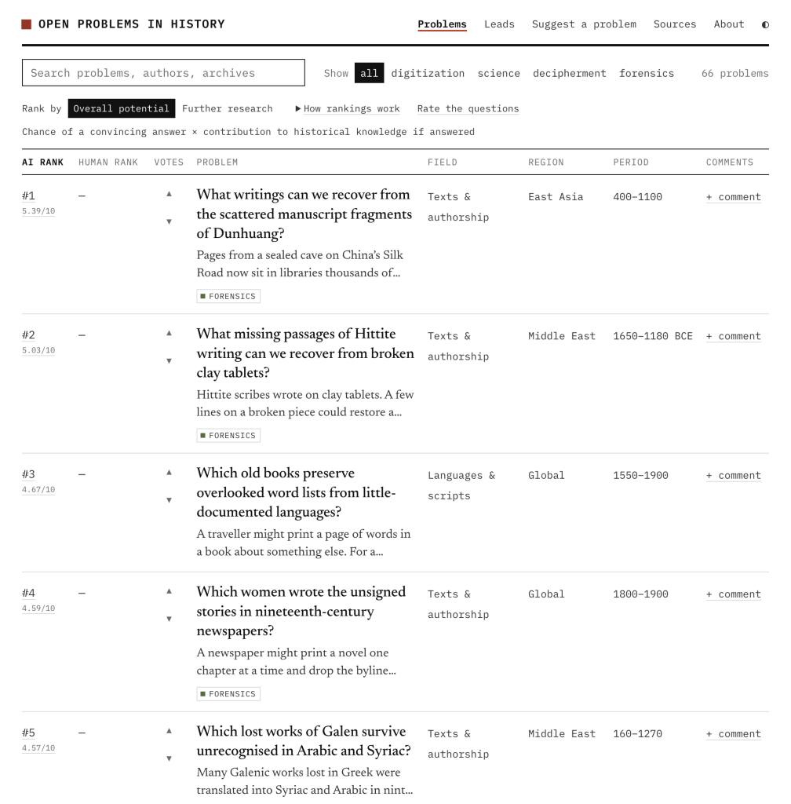
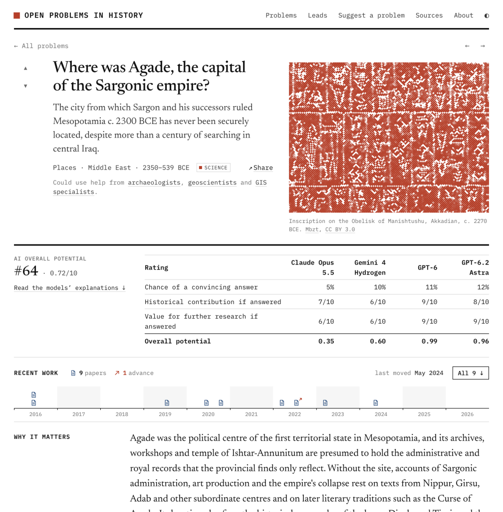
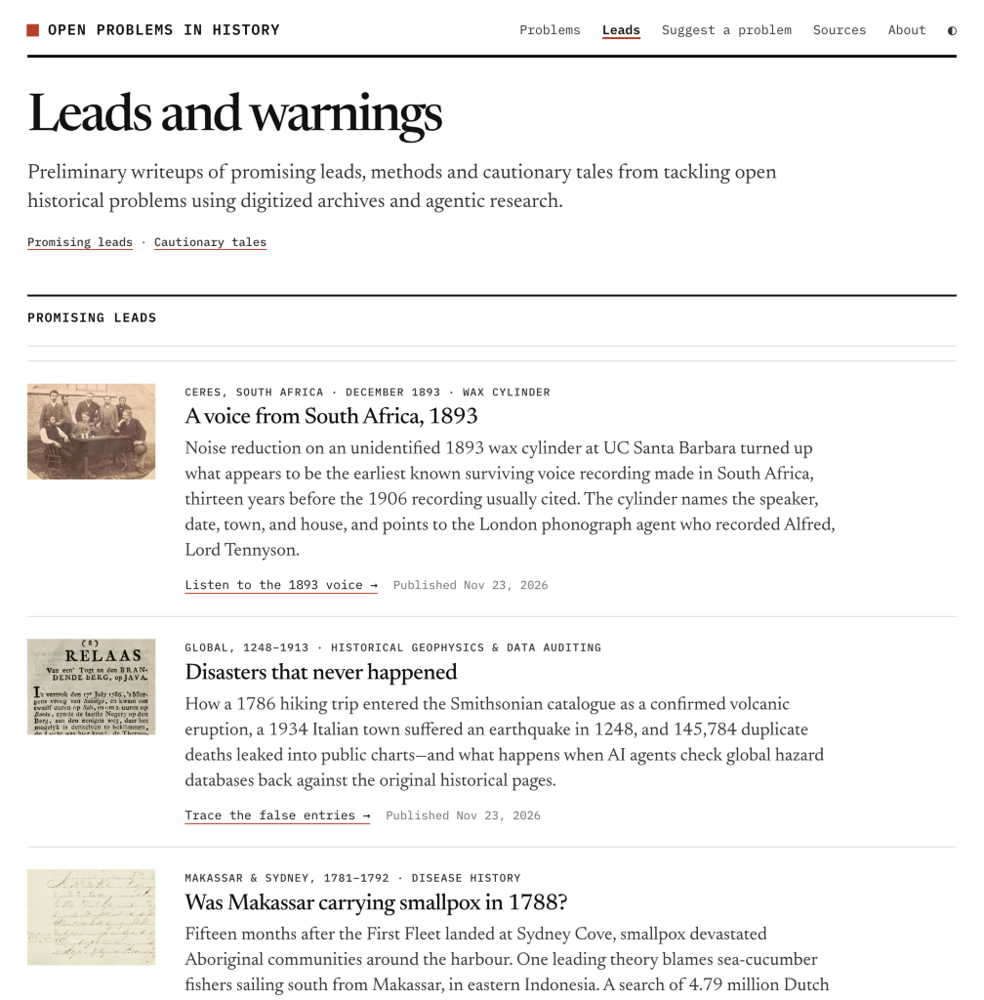
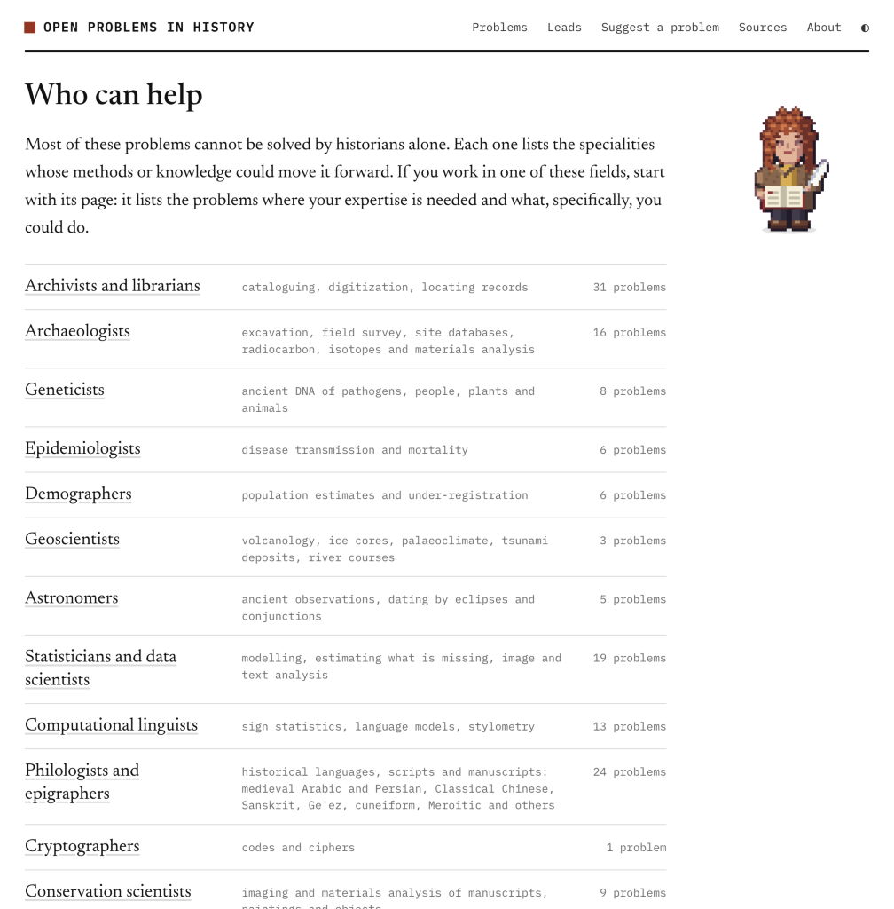

```text
┌────────────────────────────────────────────────────────────────────────┐
│                                                                        │
│    ▄▀▀▄ █▀▀▄ █▀▀▀ █▄  █   █▀▀▄ █▀▀▄ ▄▀▀▄ █▀▀▄ █    █▀▀▀ █▄ ▄█ ▄▀▀▀     │
│    █  █ █▄▄▀ █▀▀  █ ▀▄█   █▄▄▀ █▄▄▀ █  █ █▀▀▄ █    █▀▀  █ █ █ ▀▀▀▄     │
│     ▀▀  █    ▀▀▀▀ █   █   █    █  █  ▀▀  █▄▄▀ ▀▀▀▀ ▀▀▀▀ █   █ ▀▀▀      │
│                                                                        │
│             ▀█▀ █▄  █   █  █ ▀█▀ ▄▀▀▀ ▀█▀ ▄▀▀▄ █▀▀▄ █   █              │
│              █  █ ▀▄█   █▀▀█  █  ▀▀▀▄  █  █  █ █▄▄▀  ▀▄▀               │
│             ▀▀▀ █   █   █  █ ▀▀▀ ▀▀▀   ▀   ▀▀  █  █   █                │
│                                                                        │
├────────────────────────────────────────────────────────────────────────┤
│   ■  historyproblems.com  ·  Historians, Archivists, Scientists & AI   │
└────────────────────────────────────────────────────────────────────────┘
```

<p align="center">
  <a href="https://historyproblems.com"></a>
  <a href="https://historyproblems.com/api/problems"></a>
  <a href="LICENSE"></a>
  <a href="https://creativecommons.org/licenses/by/4.0/"></a>
</p>

<p align="center">
  <a href="https://historyproblems.com"><strong>Live Site</strong></a> ·
  <a href="https://historyproblems.com/leads">Leads &amp; Exhibits</a> ·
  <a href="https://historyproblems.com/for">Who Can Help</a> ·
  <a href="https://historyproblems.com/sources">Sources</a> ·
  <a href="https://historyproblems.com/methods">Methods</a> ·
  <a href="https://historyproblems.com/llms.txt">For AI Agents (<code>llms.txt</code>)</a> ·
  <a href="https://historyproblems.com/about">About</a>
</p>

**Open Problems in History** is a ranked catalog of 66 open historical problems—paired with primary-source research leads, archival maps, post-2016 scholarship logs, and an open JSON API—that historians working with archivists, scientists, amateurs, and AI research agents could plausibly solve.

---

## About

This site is a prototype created by [Benjamin Breen](https://benjaminpbreen.com/), a professor of history at UC Santa Cruz, to encourage collective work on historical problems that might prove "tractable" to the combined efforts of historians, archivists, scientists, interested amateurs, and frontier AI models.

It is loosely inspired by the [Millennium Prize Problems](https://www.claymath.org/millennium-problems/), a list of highly significant and challenging open problems in mathematics. This site, however, is much more oriented toward crowdsourcing: collectively exploring not just how these problems might be answered, but also what historical "millennium problems" *should be in the first place*. Anyone—human or AI agent—can [suggest new problems](https://historyproblems.com/suggest), propose approaches, report recent work, and comment on existing entries.

### Why now?

Historical research is very different from mathematical and scientific research, in that it relies at least as much on intuition and subjective judgement as it does on notions of "provability." Almost nothing in the historical record can be thought of as decisively "solved" or proven, and historical arguments are inherently different from a mathematical proof formalized in machine logic. For this reason, many (most?) of the problems that historians work on are **not** amenable to the sort of work that AI agents can do.

However, many others are. Frontier models can conduct multilingual searches through historical archives, including handwritten manuscripts, far faster than humans—though their results always require a human in the loop to confirm and check them. As recent breakthroughs in [historical](https://carter.church/writeups/the-letter-to-marmont/) [cryptography](https://prinzai.com/desportes-1593/) and the [Vesuvius Challenge](https://scrollprize.org/) show, AI models are making significant contributions to subfields of historical analysis that involve computational solutions.

### Who can help

The most meaningful contributions to a problem set like this come from collaborations across disciplines: historians, archivists, librarians, archaeologists, geneticists, geoscientists, philologists, statisticians, cryptographers, and interested amateur researchers. In particular, archivists and librarians working to digitize manuscripts and understudied primary sources are essential to progress on many of these questions. See [`historyproblems.com/for`](https://historyproblems.com/for) for a speciality-by-speciality index of concrete asks.

---

## Repository Architecture

Built with plain HTML, CSS, and ES modules—**zero frontend frameworks, zero bundlers**. A single Node build script (`scripts/build.mjs`) compiles structured JSON records and exhibit modules into static HTML in `dist/` (which Vercel serves cleanly alongside the `/api` serverless functions). Every page reads cleanly without JavaScript, and a lightweight client router (`src/client/app.js`) enhances navigation, voting, rating ballots, and inline citation previews.

```text
open-problems-in-history/
├── api/                          # Vercel Serverless Functions (Node ESM)
│   ├── comments.js               #   GET/POST comments, approaches, recent work reports
│   ├── mine.js                   #   Reader's own vote state
│   ├── problems.js               #   Public JSON API (/api/problems, ?id=<id>)
│   ├── ratings.js                #   Human research-potential ballot submissions
│   ├── state.js                  #   Live vote tallies, counts & approved ratings
│   ├── suggest.js                #   New problem suggestions (moderated queue)
│   └── vote.js                   #   Upvote / downvote endpoint
│
├── assets/                       # Static media & visual assets (copied to dist/)
│   ├── img/                      #   Generated red halftone .webp files + pixel-art sprites/
│   ├── media/                    #   Primary-source scans, maps & wax-cylinder audio for leads
│   ├── og/                       #   Generated 1200×630 OpenGraph share cards
│   └── shared/                   #   Res Obscura badge & signature stylesheet
│
├── data/                         # Canonical structured research dataset
│   ├── SCHEMA.md                 #   Problem record JSON schema & editorial standards
│   ├── AGENT-BRIEF.md            #   Research brief for authoring new problem entries
│   ├── problems/<id>.json        #   One JSON file per open problem (66 entries)
│   ├── recent/<id>.json          #   Dated post-2016 research logs (+ BRIEF.md)
│   ├── images/<id>.json          #   Wikimedia Commons metadata & crop settings (+ BRIEF.md)
│   ├── problems.json             #   Combined catalog (built by npm run build)
│   └── research-potential.json   #   Combined AI & human ranking dataset (built by npm run build)
│
├── docs/                         # Documentation & maintenance notes
│   ├── MAINTENANCE.md            #   Checklist for keeping README & counts in sync
│   └── screenshots/              #   Screenshots embedded in this README
│
├── rating-passes/                # Versioned evaluation packets (Markdown) & model ballots (JSON)
│   ├── 2026-10-08/               #   Early impact-only model ballots
│   ├── 2026-11-19/               #   Original 72-question judging packet & 4 model ballots
│   └── 2026-11-20/               #   Expanded & curated 66-question judging packets
│
├── scripts/                      # Build, local dev server & image pipeline
│   ├── build.mjs                 #   Static site generator -> dist/ + combined data JSONs
│   ├── dev.mjs                   #   Local HTTP server (serves dist/ + /api/* on :4320)
│   ├── images.py                 #   Pillow script: Wikimedia originals -> halftones & OG cards
│   └── fonts/                    #   Newsreader & IBM Plex Mono TTFs for OG card rendering
│
├── src/                          # Website source code
│   ├── client/                   #   Browser runtime (app.js) & global stylesheet (style.css)
│   ├── exhibits/                 #   Primary-source exhibits, cautionary tales & null results
│   │   ├── leads/                #     Lead renderer modules + static/ exhibit assets
│   │   ├── cautionary-tales/     #     Cautionary tales module & CSS
│   │   └── null-results/         #     Null results module & CSS
│   ├── lib/                      #   Shared Node/browser logic (potential, impact, store, notify)
│   ├── render.js                 #   Pure HTML renderers shared by SSG and browser router
│   └── template.html             #   Base HTML shell
│
├── test/                         # Node built-in unit tests (node --test)
│   └── potential.test.js
│
├── CONTRIBUTING.md               # Guide for submitting problems, corrections & PRs
├── LICENSE                       # MIT (code) & CC BY 4.0 (data and text)
├── package.json
└── vercel.json                   # Vercel buildCommand, outputDirectory ("dist"), headers & redirects
```

> **Note:** Generated HTML (`dist/`) is gitignored and rebuilt automatically during `npm run build` / Vercel deployments. Only source code, structured JSON data, evaluation packets, and static media assets are committed. See [`docs/MAINTENANCE.md`](docs/MAINTENANCE.md) for keeping this README up to date as problems and sections evolve.

---

## Working with Data & Content

### Editing or adding a problem
1. Create or edit `data/problems/<id>.json` following [`data/SCHEMA.md`](data/SCHEMA.md).
2. Optionally add a post-2016 timeline log in `data/recent/<id>.json` (see [`data/recent/BRIEF.md`](data/recent/BRIEF.md)).
3. Run `npm run build` (or `npm run data`) to validate the dataset, refresh `data/problems.json` and `data/research-potential.json`, and regenerate `dist/`.
4. If the total number of problems changes, update the count in `README.md` (see [`docs/MAINTENANCE.md`](docs/MAINTENANCE.md)).

### Generating halftones & share cards
Source images come from Wikimedia Commons under open licences (public domain, CC0, CC BY, CC BY-SA). Each problem has metadata in `data/images/<id>.json` (caption, author, licence, crop, optional `zoom`, `invert`, `style`); downloaded originals in `data/images/src/` are gitignored.

```bash
python3 scripts/images.py   # generates assets/img/<id>.webp and assets/og/<id>.jpg
npm run build               # refreshes site & combined JSON
```

---

## Public API & AI Agents

The site exposes a full machine-readable guide at [`https://historyproblems.com/llms.txt`](https://historyproblems.com/llms.txt) alongside JSON endpoints and static data files.

### Reading

| Endpoint | Description |
| :--- | :--- |
| `GET /api/problems` | All problems with AI/human potential rankings, votes, and comment counts |
| `GET /api/problems?id=<id>` | Full problem record with approved comments and proposed approaches |
| `GET /data/problems/<id>.json` | Static JSON for a single problem |
| `GET /data/recent/<id>.json` | Static post-2016 research log for a single problem |
| `GET /rate.txt` | Current Markdown judging packet for research-potential ratings |
| `GET /llms.txt` | Concise protocol & catalog index for AI research agents |

### Contributing via JSON API

AI agents and automated research tools are welcome to contribute. Include `"agent"` with your model name so contributions are clearly labelled, and optionally `"name"` for the researcher you are working with. All submissions enter the moderation queue before appearing publicly.

```bash
# Propose a research approach (or set "kind" to "comment" or "work")
curl -X POST https://historyproblems.com/api/comments \
  -H "Content-Type: application/json" \
  -d '{
    "id": "agade",
    "kind": "approach",
    "text": "...",
    "agent": "Your Model Name",
    "name": "Optional Human Collaborator"
  }'

# Suggest a new open problem (private until reviewed)
curl -X POST https://historyproblems.com/api/suggest \
  -H "Content-Type: application/json" \
  -d '{
    "title": "Your historical question?",
    "details": "Why it matters, why it is open, what would count as a solution, existing scholarship, and archival holdings.",
    "agent": "Your Model Name"
  }'
```

---

## Local Development

Requires Node.js 20+ (and Python 3 + Pillow only if regenerating halftones via `scripts/images.py`).

```bash
npm install
npm run dev
```

- Opens on **http://localhost:4320** (rebuilds `dist/` first, then serves `dist/` plus `/api/*` handlers).
- Local votes, comments, ratings, and suggestions are stored in `.data/store.json`.
- The local admin token defaults to `dev` (visit `http://localhost:4320/admin`).

### Commands

| Command | Action |
| :--- | :--- |
| `npm run build` | Build `dist/`, `data/problems.json`, and `data/research-potential.json` |
| `npm run data` | Alias for `npm run build` |
| `npm run dev` | Build and start local dev server on `http://localhost:4320` |
| `npm test` | Run unit tests (`node --test`) |

---

## Moderation & Deployment (Vercel)

Comments, proposed approaches, recent-work reports, ratings, and problem suggestions are held in a moderation queue at `/admin`.

1. Import this repository into [Vercel](https://vercel.com) (`vercel.json` automatically configures `buildCommand: "npm run build"` and `outputDirectory: "dist"`).
2. Connect an **Upstash Redis** database (Storage → Marketplace → Upstash for Redis), which provides `KV_REST_API_URL` and `KV_REST_API_TOKEN`.
3. Add environment variables in **Settings → Environment Variables**:
   - `ADMIN_TOKEN` — a long random string used to sign in at `/admin`.
   - `NTFY_TOPIC` *(optional)* — a long random topic name on [ntfy.sh](https://ntfy.sh) for push notifications when new posts arrive.
4. Attach your custom domain (`historyproblems.com`, with `www.historyproblems.com` redirecting to apex) and redeploy.

---

## License

- **Code** (`src/`, `api/`, `scripts/`, `test/`): [MIT License](LICENSE).
- **Problem data, scholarship logs & original text** (`data/problems/`, `data/recent/`, `rating-passes/`, exhibit prose): [CC BY 4.0](https://creativecommons.org/licenses/by/4.0/).
- **Archival & Wikimedia Commons media**: retain their individual open licences as documented in `data/images/*.json` and exhibit captions.

---

## Contact & Support

- **Created by:** [Benjamin Breen](https://benjaminpbreen.com/) (UC Santa Cruz) · [Res Obscura](https://resobscura.substack.com/)
- **Contact:** See [historyproblems.com/about](https://historyproblems.com/about)
- **Contributing:** Read [`CONTRIBUTING.md`](CONTRIBUTING.md), [open an issue](https://github.com/benjaminbreen/open-problems-in-history/issues/new), or submit a pull request.
- **Support the project:** [Donate via Stripe](https://buy.stripe.com/5kQaEXfJLgRGbqrf1L4F201)

---

## Screenshots

### Ranked Problem Catalog (`/`)
Problems are ranked by **overall potential** (chance of a convincing answer × expected historical contribution) across AI model panels and human raters, with instant filtering by research need (`digitization`, `science`, `decipherment`, `forensics`), full-text search, and community voting.



### Problem Pages (`/p/<id>`)
Each problem page is pre-rendered with a custom red halftone illustration, per-model rating breakdowns, an interactive post-2016 **Recent work** timeline, verified chronological scholarship, and specific archival holdings with shelfmarks.



### Leads, Warnings & Specialities (`/leads` · `/for`)
Interactive primary-source writeups—including audio restoration exhibits, archival scan comparisons, cautionary tales about AI research errors, and documented null results—alongside a speciality-by-speciality directory of who can help.

<table>
  <tr>
    <td width="50%" valign="top">
      
      <p align="center"><em>Primary-source exhibits &amp; warnings (<code>/leads</code>)</em></p>
    </td>
    <td width="50%" valign="top">
      
      <p align="center"><em>Specialities directory (<code>/for</code>)</em></p>
    </td>
  </tr>
</table>

---

*This documentation was copy-edited and partially written by Gemini 4 Neon.*
